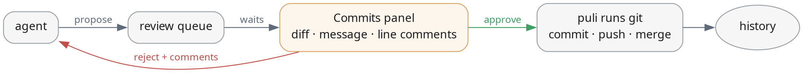

<p align="center"></p>

<h3 align="center">herdr-puli</h3>

<p align="center">Git gate for OpenCode agents, reviewed in the Herdr app.<br>Agents propose. You approve, reject, or comment.<br>No commit, push, merge or rebase happens without you.</p>

---

## How it works

<p align="center"></p>

<sub>Diagram source: [`docs/flow.dot`](docs/flow.dot) — edit and re-render with `dot -Tpng docs/flow.dot -o docs/flow.png`.</sub>

- **The gate**: `git commit` and `git push` are denied to agents. The puli plugin is the only thing that runs them — after your approval.
- **Full fence coverage**: every fenced git command has a gated path — `commit_request` / `push_request` for commits and pushes (with diff preview), the generic `git_request` for merge / rebase / cherry-pick / revert / plumbing.
- **The panel**: a Commits tab in the Herdr app. Full commit message, Zed-style inline diff (hover the red markers to see removed lines), approve / reject on the card.
- **Line comments**: click diff lines, write why they're wrong. Reject sends them to the agent as `file:line-range` references — no hand-typed line numbers.
- **CLI**: `puli pending · show · diff · approve · reject` from any terminal.

## Install

Requires [OpenCode](https://opencode.ai) v2, [Bun](https://bun.sh), and the [Herdr app](https://herdr.dev) for the panel.

```sh
git clone https://github.com/Hurka5/herdr-puli.git
cd herdr-puli
bun install
./install.sh
```

Then paste the deny rules into `~/.config/opencode/opencode.jsonc` — the installer prints them, or take them from [README-fence](#the-fence) below. Without them agents can commit around the gate.

## The fence

```jsonc
"permissions": [
  { "action": "shell", "resource": "git commit*",      "effect": "deny" },
  { "action": "shell", "resource": "git * commit*",    "effect": "deny" },
  { "action": "shell", "resource": "git push*",        "effect": "deny" },
  { "action": "shell", "resource": "git * push*",      "effect": "deny" },
  { "action": "shell", "resource": "*--no-verify*",    "effect": "deny" },
  { "action": "shell", "resource": "git merge*",       "effect": "deny" },
  { "action": "shell", "resource": "git rebase*",      "effect": "deny" },
  { "action": "shell", "resource": "git cherry-pick*", "effect": "deny" },
  { "action": "shell", "resource": "git revert*",      "effect": "deny" },
  { "action": "shell", "resource": "git commit-tree*", "effect": "deny" },
  { "action": "shell", "resource": "git update-ref*",  "effect": "deny" }
]
```

## Layout

| path | what |
|---|---|
| `src/` | OpenCode plugin — `commit_request`, `push_request`, history |
| `herdr-app/mods/puli/` | the Commits panel |
| `bin/puli` | CLI |
| `skills/commit-gate/` | teaches every agent session the flow |
| `install.sh` | machine setup, idempotent |

State lives in `~/.local/state/puli` (`pending/`, `verdict.json`, `history.jsonl`). Proposals expire on their own; dead cards never stick.

## Notes

- The answer file is `verdict.json` — never rename it to `decision.json` (some setups reap that name).
- Panel edits hot-reload; under heavy load the Herdr watcher can lag a minute. Restarting the app window always applies instantly.
